# Estructura del Directorio

|-wg-client-simple, cuerpo del cliente

|-wg-server-simple, servidor de actualización, utilizado para guardar nuevas versiones del software

|-wg-update-simple, programa de actualización, utilizado para actualizar el cliente

|-example Casos de ejemplo del proyecto, el formato de nombre del paquete jar empaquetado debe ser el mismo que el de su interior

Nombre del paquete jar del cliente: wg-client-simple.jar

Nombre del paquete jar del programa de actualización: wg-update-simple.jar

# Diseño de la Interfaz Principal:

## 1. Pantalla de Inicio de Sesión

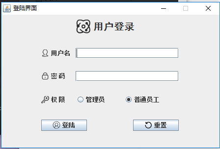

## 2. Página Principal

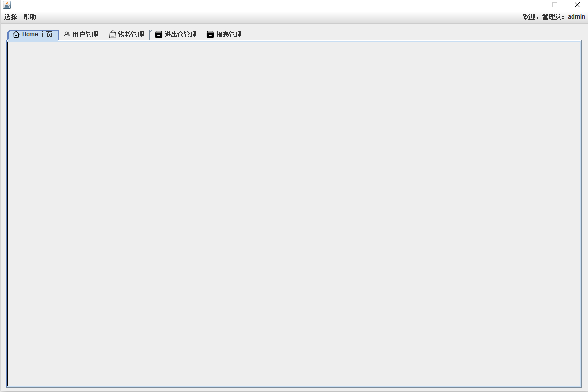

## 3. Modificación de Información del Usuario Iniciado

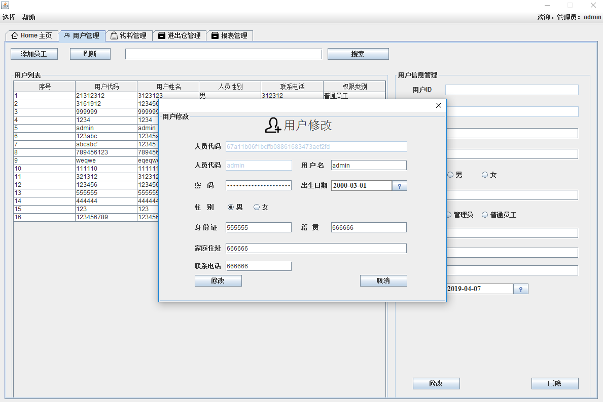

## 4. Gestión de Usuarios

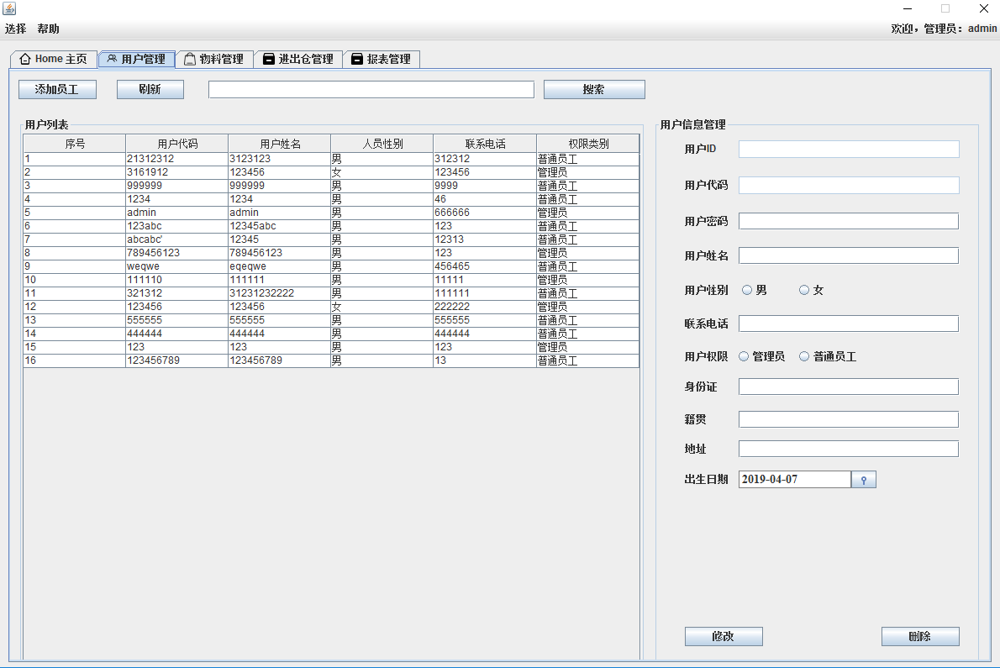

## 5. Adición de Empleados

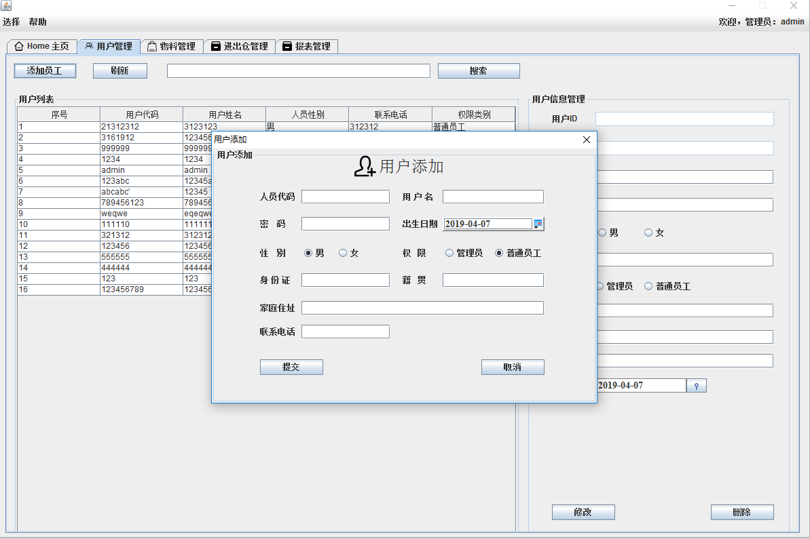

## 6. Gestión de Materiales

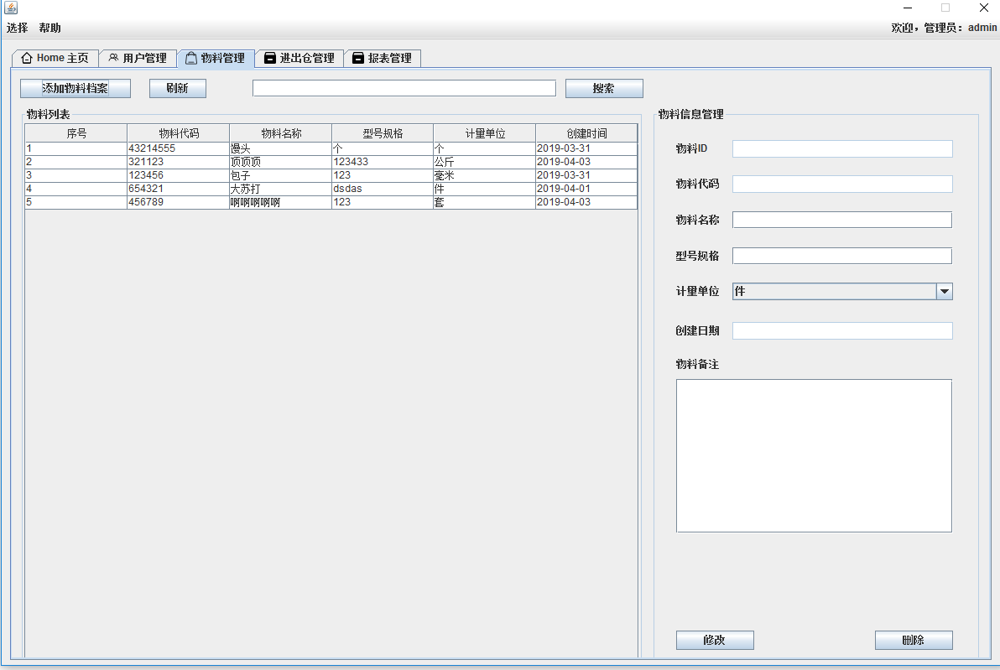

## 7. Adición de Archivos de Materiales

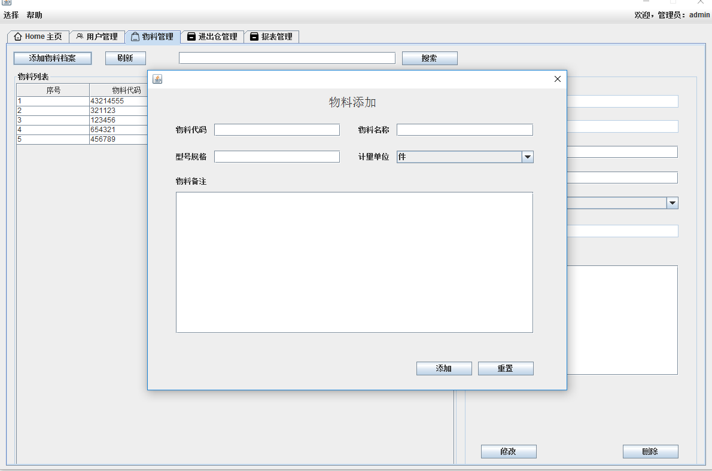

## 8. Gestión de Entradas y Salidas de Almacén

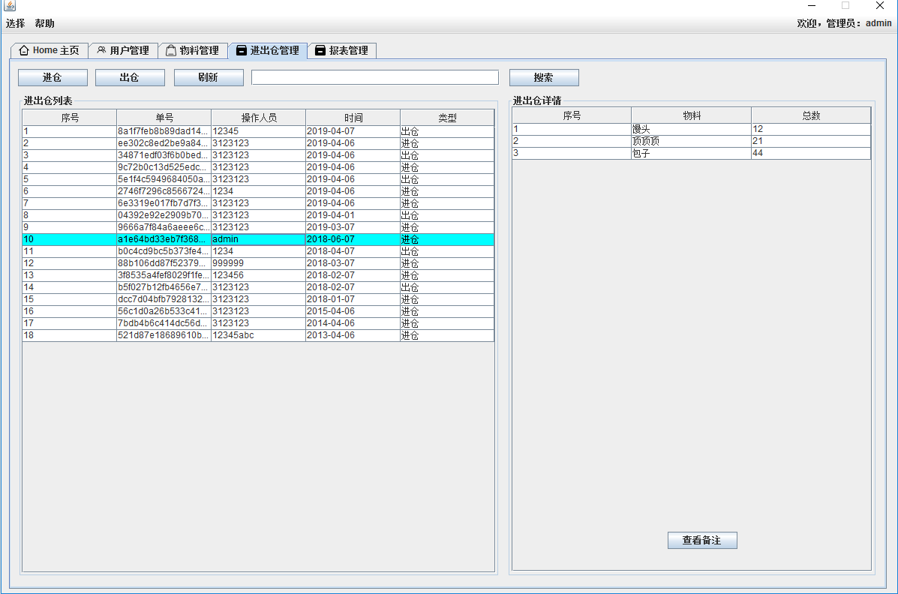

## 9. Agregar Registro de Entrada de Almacén

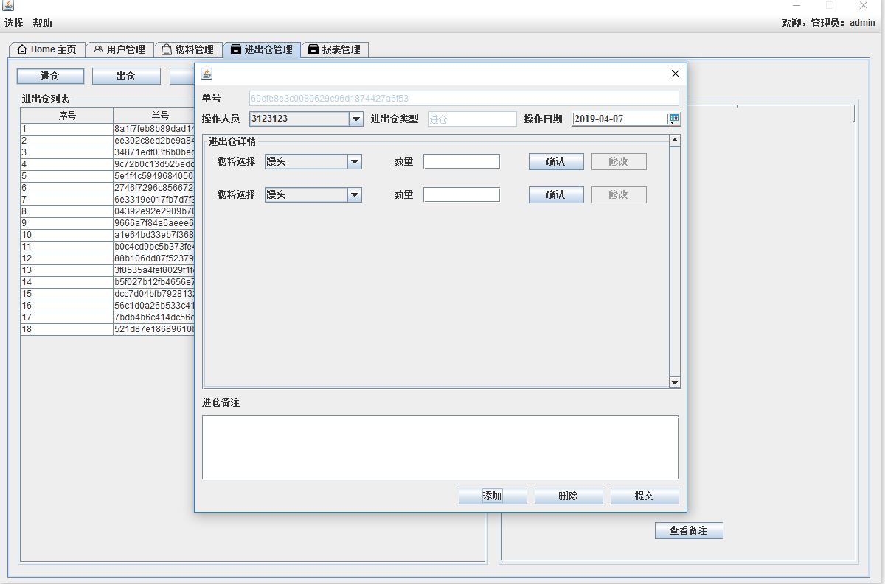

## 10. Agregar Registro de Salida de Almacén

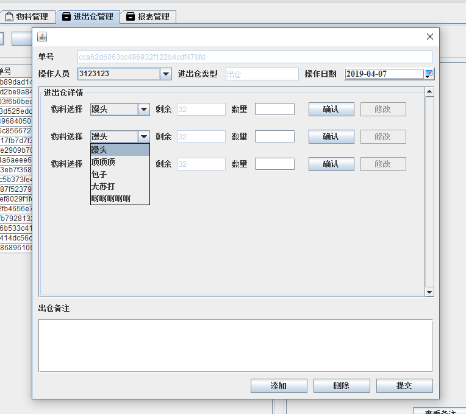

## 11. Gestión de Reportes

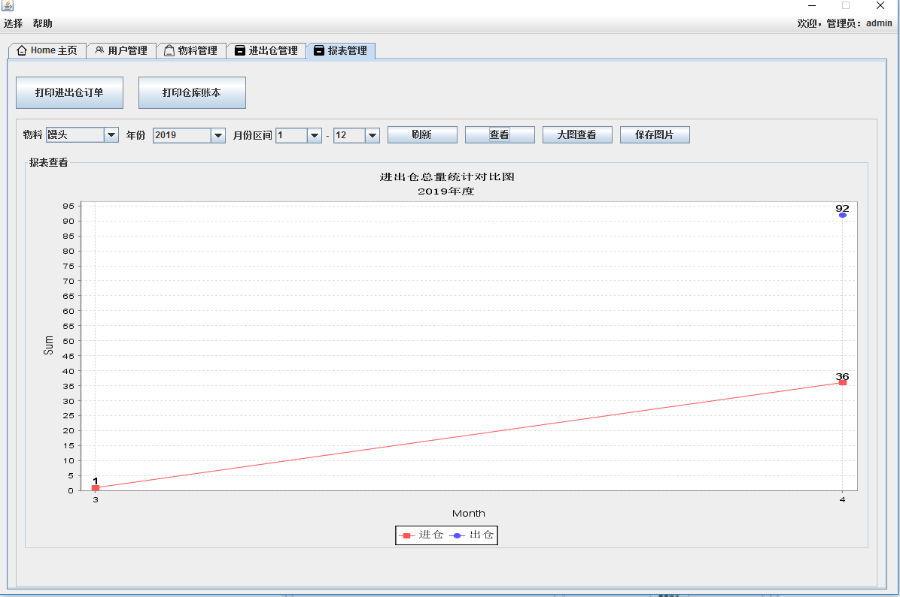

## 12 Impresión de Reportes

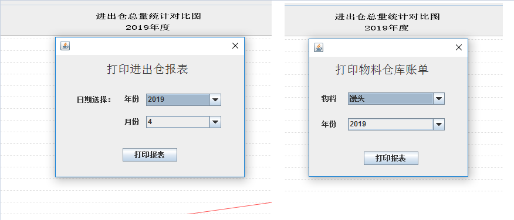

# 13 Servidor de Actualización de la Aplicación

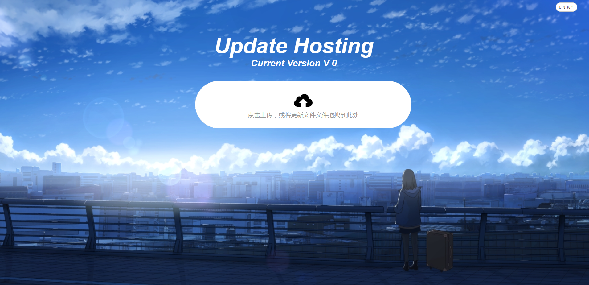
